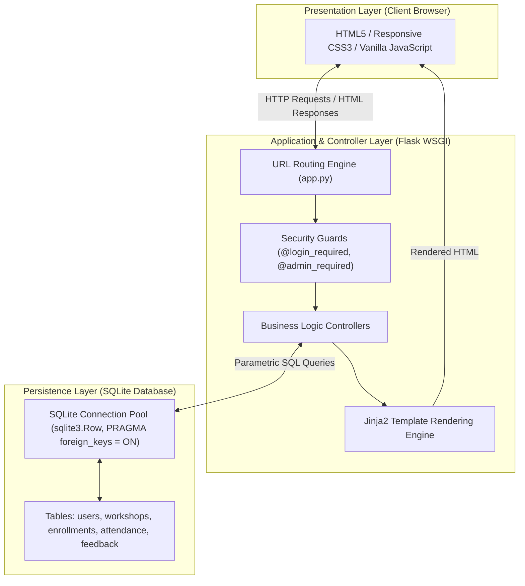
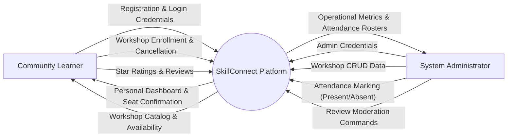
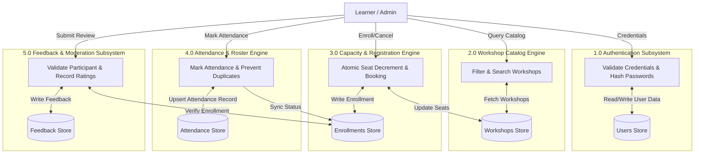
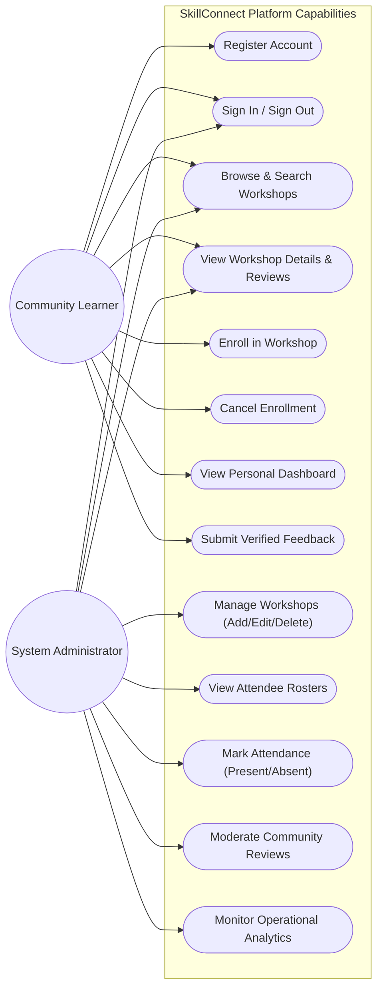
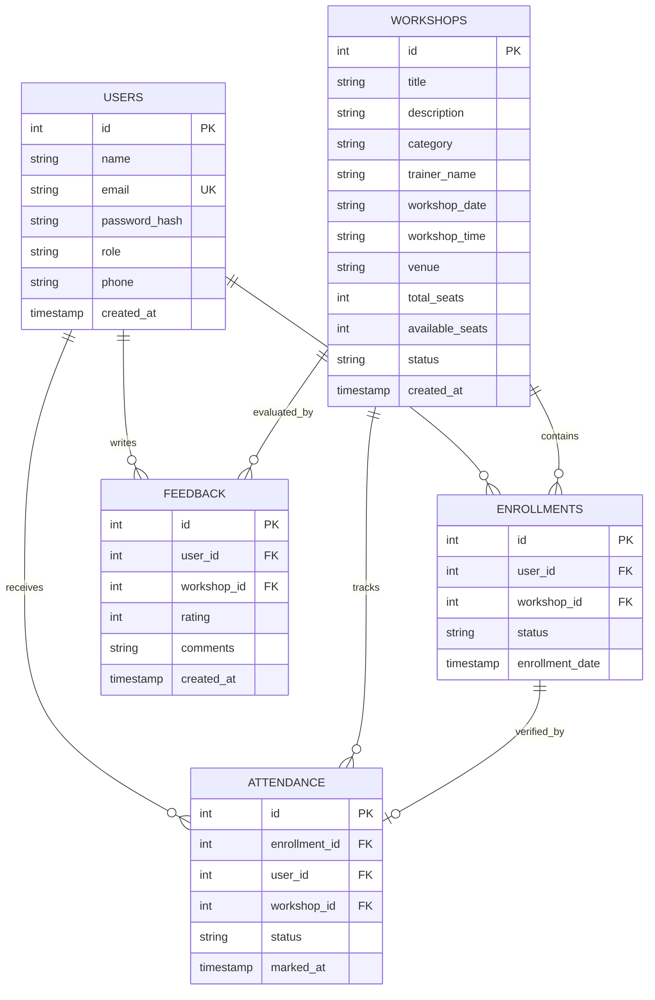

# A MINI-PROJECT REPORT
ON
# COMMUNITY SKILL-BUILDING WORKSHOP PLATFORM
**(SkillConnect)**

*Submitted in partial fulfillment of the requirements for the award of the Degree of*  
**BACHELOR OF TECHNOLOGY / BACHELOR OF ENGINEERING**  
*in*  
**COMPUTER SCIENCE AND ENGINEERING / INFORMATION TECHNOLOGY**

---

### **Submitted By:**
**Student Name:** [Your Name / Candidate Name]  
**University Register No:** [Your Register Number]  
**Department:** Department of Computer Science & Engineering  
**Academic Year:** 2025 – 2026  

---

### **Under the Guidance of:**
**Project Guide / Internal Supervisor:**  
[Faculty Name / Designation]  
Department of Computer Science & Engineering  

---

<br>

## TABLE OF CONTENTS
1. Cover Page
2. Abstract
3. Introduction
4. Problem Statement
5. Objectives
6. Scope
7. Existing System
8. Proposed System
9. Hardware Requirements
10. Software Requirements
11. System Architecture
12. Data Flow Diagram (DFD)
13. Use Case Diagram
14. Entity-Relationship (ER) Diagram
15. Database Design
16. Module Descriptions
17. Implementation Details
18. User Interface Layouts & Views
19. Testing and Results
20. Advantages
21. Limitations
22. Future Enhancements
23. Conclusion
24. References

---

## 2. ABSTRACT

In contemporary society, continuous learning and skill acquisition are essential for personal growth, career advancement, and local community resilience. However, traditional education systems and commercial training bootcamps are often cost-prohibitive, rigid in scheduling, and divorced from localized grassroots needs. The **Community Skill-Building Workshop Platform (*SkillConnect*)** is an open-access, web-based software application designed to facilitate peer-to-peer and mentor-guided skill development within local communities.

Developed using Python Flask, SQLite, semantic HTML5, modern vanilla JavaScript, and an emerald-and-white responsive CSS design system, the platform establishes a centralized ecosystem where community members can register as learners, explore scheduled workshops across diverse disciplines (Technology, Business, Crafts, Communication, and Environment), view comprehensive logistics, reserve seats with real-time capacity decrementing, and submit verified feedback reviews. Concurrently, administrators are provided with dedicated role-based control centers to publish and manage workshop inventories, track participant rosters, monitor attendance records (Present/Absent), and moderate feedback.

The application eliminates administrative friction through automated transactional guarantees, atomic seat decrementing, and database-level integrity enforcement (foreign key cascades, check constraints, and unique indexes). The system has been validated through an automated test suite comprising 56 unit, integration, and audit test cases with a 100% pass rate, ensuring high reliability, strict role-based access control, responsive mobile accessibility, and data integrity.

---

## 3. INTRODUCTION

The rapid evolution of technology and industry demands continuous upskilling. While digital resources such as massive open online courses (MOOCs) are widely available, they often suffer from low completion rates due to a lack of hands-on mentorship, practical accountability, and interpersonal connection. Local community workshops bridge this gap by offering focused, interactive, and small-group learning experiences led by experienced practitioners.

Managing such community learning initiatives manually—through paper rosters, disconnected spreadsheets, or informal messaging channels—incurs severe logistical bottlenecks, including duplicate registrations, overbooked venues, untracked attendance, and lost feedback. 

**SkillConnect** addresses these operational hurdles by providing a lightweight, unified digital infrastructure. The application implements a modern multi-tier web architecture that connects community learners with local workshops while giving organizers transparent operational control. With a focus on accessibility, ease of use, data security, and responsive design, the platform empowers community centers, educational institutions, and non-profit organizations to run sustainable skill-building programs.

---

## 4. PROBLEM STATEMENT

Manual and ad-hoc workshop coordination mechanisms suffer from critical operational deficiencies:
1. **Inefficient Registration Processes:** Manual sign-up sheets or paper forms result in data entry errors, illegible contact records, and duplicate submissions.
2. **Lack of Capacity Enforcement:** Organizers frequently face venue overcrowding or empty seats due to the absence of real-time seat inventory tracking.
3. **Absence of Role Separation:** Unrestricted spreadsheets allow accidental data overwrites and expose participant personal data to unauthorized parties.
4. **Poor Attendance Accounting:** Physical sign-in sheets are easily misplaced, delaying certification and making attendance auditing cumbersome.
5. **No Structured Feedback Loop:** Learners rarely have a formal channel to provide qualitative and quantitative reviews, preventing organizers from evaluating mentor performance or course relevance.
6. **Inaccessible Mobile Interfaces:** Traditional community portals lack responsive layouts, making mobile browsing difficult for non-desktop users.

---

## 5. OBJECTIVES

The primary objectives of the Community Skill-Building Workshop Platform are:
1. **Centralized Workshop Catalog:** Deliver a public, searchable, and category-filtered catalog of skill-building workshops with transparent schedules, venue logistics, and seating availability.
2. **Automated Seat Management:** Provide atomic, database-backed enrollment where available seats decrement automatically upon reservation and increment upon cancellation, preventing overbooking.
3. **Role-Based Access Control (RBAC):** Enforce strict authentication barriers separating general learners from administrative staff using PBKDF2 password hashing and secure session state.
4. **Attendance Tracking Subsystem:** Enable administrators to mark and verify attendee presence (Present/Absent) with database upsert constraints that strictly prevent duplicate records.
5. **Verified Participant Feedback:** Permit only registered workshop attendees to rate sessions (1 to 5 stars) and write constructive reviews, maintaining high community credibility.
6. **Administrative Operations Center:** Provide organizers with complete CRUD capabilities (Create, Read, Update, Delete) over workshop schedules and real-time operational metrics.
7. **Responsive & Accessible Presentation:** Implement a clean, green-and-white visual interface that functions seamlessly across mobile smartphones, tablets, and desktop displays.

---

## 6. SCOPE

### In-Scope Capabilities:
* User registration, password encryption with PBKDF2-SHA256, login, session termination (logout), and open-redirect protected routing.
* Public catalog display, live client-side searching, server-side keyword search queries, and categorical filtering.
* Detailed workshop pages displaying syllabus, lead trainer credentials, schedule, venue, seat counter, and attendee testimonials.
* Learner self-service dashboard displaying personal metrics, upcoming registered sessions, full registration history, and profile attributes.
* Real-time seat reservation, atomic decrementing, duplicate enrollment blocking, full-capacity blocking, and seat-restoring cancellation.
* Administrative control center featuring live SQLite metrics, workshop inventory management, real-time client-side search/filter, and review moderation.
* Attendance roster with per-workshop filtering, participant contact information, and one-click attendance recording.
* Verified review submission with 1–5 star validation and feedback moderation.

### Out-of-Scope (Future Potential):
* Payment gateway integration (as the current platform is designed for 100% free community workshops).
* Automated SMS/email dispatch gateways (external SMTP/SMS provider integration).
* Native mobile applications (iOS/Android binaries).

---

## 7. EXISTING SYSTEM

In many municipal community centers, non-governmental organizations, and college extracurricular clubs, workshop management is conducted via fragmented tools:
* **Paper-Based Rosters:** Sign-up sheets posted on physical bulletin boards.
* **Shared Spreadsheets:** Google Sheets or Excel workbooks shared via links without cell-level access controls.
* **Generic Messaging Groups:** WhatsApp or Telegram groups where announcements are broadcast without organized scheduling or confirmation tracking.

### Disadvantages of the Existing System:
* High operational overhead and manual transcription labor.
* High incidence of duplicate bookings and overbooking beyond fire/venue limits.
* Vulnerability to unauthorized data modifications or accidental row deletions.
* Inability for learners to track their personal learning history in one place.
* High rate of no-shows due to lack of self-service cancellation mechanisms.

---

## 8. PROPOSED SYSTEM

The proposed **SkillConnect** platform provides an automated, centralized web solution built on Python Flask and SQLite:
* **Automated Data Integrity:** SQLite database constraints (`FOREIGN KEY ... ON DELETE CASCADE`, `UNIQUE(user_id, workshop_id)`, `CHECK`) guarantee zero orphaned records and zero duplicate registrations.
* **Atomic Capacity Decrementing:** The database enforces non-negative available seat counts; once capacity reaches zero, the system automatically disables registration controls.
* **Cryptographic Security:** Passwords are never stored in plaintext; Werkzeug PBKDF2-SHA256 hashing protects user credentials.
* **Separation of Concerns:** Learners access dedicated dashboards, while administrators utilize privileged control rooms guarded by server-side decorators (`@login_required`, `@admin_required`).
* **Audited Attendance & Verified Reviews:** Only genuine attendees can submit ratings, preventing review spam and providing instructors with actionable feedback.

---

## 9. HARDWARE REQUIREMENTS

### Development & Host Server Environment:
* **Processor:** Intel Core i3 / AMD Ryzen 3 or higher (Dual-Core 2.0 GHz minimum).
* **RAM:** 4 GB minimum (8 GB recommended for concurrent test execution).
* **Storage:** 500 MB available storage for application files, SQLite database, and virtual environment.
* **Network:** Standard network adapter (TCP/IP) for local intranet or cloud hosting.

### Client / End-User Environment:
* **Devices:** Desktop PC, Laptop, Tablet, or Smartphone.
* **Display Resolution:** Minimum 320px width (Mobile) up to 4K Ultra HD.

---

## 10. SOFTWARE REQUIREMENTS

* **Operating System:** Windows 10/11, Ubuntu Linux 20.04+, or macOS.
* **Programming Language:** Python 3.10, 3.11, or 3.12.
* **Web Framework:** Flask 3.0.3 (WSGI micro-framework).
* **Security & Utility Library:** Werkzeug 3.0.3.
* **Database Engine:** SQLite 3 (Embedded relational database engine).
* **Web Browser:** Any modern ECMAScript 6-compliant web browser (Google Chrome, Mozilla Firefox, Microsoft Edge, Apple Safari).
* **Development Tools:** VS Code / Antigravity IDE, PowerShell / Bash Terminal.

---

## 11. SYSTEM ARCHITECTURE

The platform follows the classic **Model-Template-View (MTV) / Layered MVC Architecture**:



1. **Client / Presentation Layer:** Consists of standards-compliant HTML5 templates styled with modern CSS variables, responsive flexbox/grid containers, and asynchronous DOM manipulation scripts for real-time table and catalog filtering.
2. **Application / Controller Layer:** Powered by Flask. Routes incoming HTTP requests, enforces role-based access decorators, executes parameterized SQL transactions, computes real-time summary statistics, and passes data to Jinja2 templates.
3. **Data / Persistence Layer:** SQLite 3 database operating with explicit foreign key constraints (`PRAGMA foreign_keys = ON`). Maintains relational integrity across users, workshops, registrations, attendance rosters, and feedback reviews.

---

## 12. DATA FLOW DIAGRAMS (DFD)

### 12.1 DFD Level 0 (Context Diagram)



### 12.2 DFD Level 1 (Decomposition Diagram)



---

## 13. USE CASE DIAGRAM



---

## 14. ENTITY-RELATIONSHIP (ER) DIAGRAM



---

## 15. DATABASE DESIGN

The relational schema is implemented in SQLite 3 with strict foreign key constraints enabled.

### 15.1 Table: `users`
Stores learner and administrator credentials and profile data.
| Column Name | Data Type | Constraints | Description |
|---|---|---|---|
| `id` | INTEGER | PRIMARY KEY AUTOINCREMENT | Unique user identifier |
| `name` | TEXT | NOT NULL | Full name of user |
| `email` | TEXT | UNIQUE NOT NULL | Unique email address used for login |
| `password_hash` | TEXT | NOT NULL | PBKDF2-SHA256 salted password hash |
| `role` | TEXT | NOT NULL DEFAULT 'learner' CHECK(role IN ('learner', 'admin')) | System access role |
| `phone` | TEXT | NULLABLE | Contact telephone number |
| `created_at` | TIMESTAMP | DEFAULT CURRENT_TIMESTAMP | Account creation timestamp |

### 15.2 Table: `workshops`
Stores skill workshop inventory, schedules, trainer info, and seating availability.
| Column Name | Data Type | Constraints | Description |
|---|---|---|---|
| `id` | INTEGER | PRIMARY KEY AUTOINCREMENT | Unique workshop identifier |
| `title` | TEXT | NOT NULL | Workshop title |
| `description` | TEXT | NOT NULL | Detailed syllabus and prerequisites |
| `category` | TEXT | NOT NULL | Category (e.g., Technology, Crafts) |
| `trainer_name` | TEXT | NOT NULL | Lead trainer / instructor name |
| `workshop_date`| TEXT | NOT NULL | Date in YYYY-MM-DD format |
| `workshop_time`| TEXT | NOT NULL | Time string (e.g., 10:00 AM - 01:00 PM) |
| `venue` | TEXT | NOT NULL | Venue, room number, or meeting link |
| `total_seats` | INTEGER | NOT NULL CHECK(total_seats > 0) | Maximum seating capacity |
| `available_seats`| INTEGER | NOT NULL CHECK(available_seats >= 0) | Remaining vacant seats |
| `status` | TEXT | NOT NULL DEFAULT 'upcoming' CHECK(status IN ('upcoming', 'completed', 'cancelled')) | Operational lifecycle status |
| `created_at` | TIMESTAMP | DEFAULT CURRENT_TIMESTAMP | Workshop record creation time |

### 15.3 Table: `enrollments`
Tracks learner seat bookings and enrollment states.
| Column Name | Data Type | Constraints | Description |
|---|---|---|---|
| `id` | INTEGER | PRIMARY KEY AUTOINCREMENT | Unique enrollment identifier |
| `user_id` | INTEGER | NOT NULL, FOREIGN KEY REFERENCES users(id) ON DELETE CASCADE | Enrolled learner ID |
| `workshop_id` | INTEGER | NOT NULL, FOREIGN KEY REFERENCES workshops(id) ON DELETE CASCADE | Enrolled workshop ID |
| `enrollment_date`| TIMESTAMP| DEFAULT CURRENT_TIMESTAMP | Timestamp of booking |
| `status` | TEXT | NOT NULL DEFAULT 'confirmed' CHECK(status IN ('confirmed', 'cancelled', 'attended', 'Present', 'Absent')) | Current booking status |
| **Constraint** | UNIQUE | `UNIQUE(user_id, workshop_id)` | Prevents duplicate enrollments |

### 15.4 Table: `attendance`
Stores verified presence or absence records.
| Column Name | Data Type | Constraints | Description |
|---|---|---|---|
| `id` | INTEGER | PRIMARY KEY AUTOINCREMENT | Unique attendance identifier |
| `enrollment_id`| INTEGER | NOT NULL, FOREIGN KEY REFERENCES enrollments(id) ON DELETE CASCADE | Associated enrollment ID |
| `user_id` | INTEGER | NOT NULL, FOREIGN KEY REFERENCES users(id) ON DELETE CASCADE | Participant user ID |
| `workshop_id` | INTEGER | NOT NULL, FOREIGN KEY REFERENCES workshops(id) ON DELETE CASCADE | Workshop attended |
| `status` | TEXT | NOT NULL CHECK(status IN ('Present', 'Absent')) | Verified status |
| `marked_at` | TIMESTAMP | DEFAULT CURRENT_TIMESTAMP | Time marked by administrator |
| **Constraint** | UNIQUE | `UNIQUE(user_id, workshop_id)` | Prevents duplicate attendance records |

### 15.5 Table: `feedback`
Stores ratings and constructive reviews submitted by registered attendees.
| Column Name | Data Type | Constraints | Description |
|---|---|---|---|
| `id` | INTEGER | PRIMARY KEY AUTOINCREMENT | Unique feedback identifier |
| `user_id` | INTEGER | NOT NULL, FOREIGN KEY REFERENCES users(id) ON DELETE CASCADE | Reviewing participant ID |
| `workshop_id` | INTEGER | NOT NULL, FOREIGN KEY REFERENCES workshops(id) ON DELETE CASCADE | Reviewed workshop ID |
| `rating` | INTEGER | NOT NULL CHECK(rating BETWEEN 1 AND 5) | Star rating (1 to 5) |
| `comments` | TEXT | NOT NULL | Constructive text testimonial |
| `created_at` | TIMESTAMP | DEFAULT CURRENT_TIMESTAMP | Review submission timestamp |
| **Constraint** | UNIQUE | `UNIQUE(user_id, workshop_id)` | Restricts users to one review per workshop |

---

## 16. MODULE DESCRIPTIONS

### 16.1 Authentication & Access Control Module
* **Registration:** Validates full name length (minimum 2 characters), RFC-compliant email structure, and password length (minimum 6 characters). Uses Werkzeug's `generate_password_hash` with PBKDF2-SHA256.
* **Login & Session Management:** Authenticates credentials via `check_password_hash`. Regenerates session upon successful authentication to defend against session fixation attacks. Implements open-redirect validation on the `next` query parameter.
* **Role-Based Guards:** Custom Python decorators `@login_required` and `@admin_required` guard protected routes, redirecting unauthenticated or unauthorized users with contextual flash alert banners.

### 16.2 Workshop Catalog & Discovery Module
* **Public Exploration:** Lists workshops ordered by date. Renders category pills, instructor names, logistics, and real-time seat availability badges (`X of Y seats left` or `Fully Booked`).
* **Live & Server Search:** Provides instant client-side filtering via JavaScript (`script.js`) and server-side SQL parameterized query filtering (`LOWER(title) LIKE ? OR LOWER(trainer_name) LIKE ?`).
* **Category Filtering:** Dynamically queries distinct categories from SQLite, supporting single-click filtering for streams like Technology, Business, Crafts, Environment, and Communication.

### 16.3 Workshop Details & Booking Engine
* **Detailed Logistics View:** Displays workshop syllabus, trainer bio, date, time, venue, and attendee reviews.
* **Atomic Seat Decrement:** Verifies workshop status is `'upcoming'` and `available_seats > 0` before inserting into `enrollments` and decrementing `available_seats` atomically within a database transaction.
* **Duplicate Prevention:** Checks existing records; blocks duplicate bookings with informative warnings while allowing reactivation of previously cancelled seats.
* **Cancellation & Restoration:** Allows learners to cancel confirmed seats from their dashboard, automatically incrementing `available_seats` back to inventory.

### 16.4 Learner Personal Dashboard Module
* **Dynamic Analytics:** Computes live statistics from SQLite: Total Registered, Upcoming Sessions, Completed Workshops, and Feedback Shared.
* **Registration History Roster:** Displays a chronological table of active and completed bookings with direct actions to view details, cancel seats, or submit feedback.
* **Profile Verification:** Displays account attributes, registered phone/email, and security encryption status.
* **Course Recommendations:** Recommends relevant upcoming workshops with vacant seats that the learner has not yet enrolled in.

### 16.5 Attendance & Participant Roster Module
* **Admin Attendee Roster:** Displays participant contact information (name, email, phone) grouped by workshop. Includes an instant dropdown filter.
* **Attendance Tracking:** Allows administrators to mark participant attendance as `'Present'` or `'Absent'`.
* **Duplicate Prevention via Upsert:** Employs SQLite `ON CONFLICT(user_id, workshop_id) DO UPDATE` to ensure repeat clicks update the existing attendance row rather than creating duplicates.
* **Status Synchronization:** Synchronizes status between `attendance` and `enrollments` tables.

### 16.6 Feedback & Review Subsystem
* **Participant Restriction:** Verifies the user has a confirmed or attended enrollment in the target workshop before allowing feedback submission.
* **Rating Validation:** Enforces integer bounds between 1 and 5 stars on both client (interactive radio stars) and server. Rejects comments shorter than 3 characters.
* **Review Moderation:** Administrators can review and delete inappropriate testimonials directly from the admin dashboard with cascade safety.

---

## 17. IMPLEMENTATION DETAILS

### 17.1 Backend Web Architecture ([app.py](file:///d:/Community%20skill%20development%20project/Community%20skill%20development%20project/community-skill-workshop/app.py))
* Implemented in Flask 3.0.3 using Python standard libraries (`sqlite3`, `functools.wraps`, `os`, `re`).
* Configures application context teardown handlers (`close_db`) ensuring SQLite connection file handles are closed cleanly at the end of each request lifecycle.
* Implements dedicated error handlers `@app.errorhandler(404)` and `@app.errorhandler(500)` rendering styled templates.

### 17.2 Security Implementation
* **Password Hashing:** Utilizes PBKDF2 with SHA-256 and salt (`generate_password_hash(password, method='pbkdf2:sha256')`).
* **SQL Injection Protection:** All database interactions utilize parameterized queries (e.g., `db.execute("SELECT * FROM users WHERE email = ?", (email,))`).
* **Cross-Site Scripting (XSS) Prevention:** Jinja2 auto-escaping is active across all template rendering contexts.
* **Open Redirect Defense:** The login redirect logic enforces that the `next` destination begins with a single forward slash (`/`) and does not begin with double slashes (`//`).

### 17.3 Frontend Design System ([style.css](file:///d:/Community%20skill%20development%20project/Community%20skill%20development%20project/community-skill-workshop/static/css/style.css))
* Employs CSS Custom Properties (Variables) for color palettes, shadows, radii, and transitions.
* **Responsive Breakpoints:** Configured at `992px`, `900px`, and `768px` for flexible mobile adaptability.
* **Glassmorphic Navigation:** Uses `backdrop-filter: blur(14px)` with high-contrast text and a mobile hamburger drawer.

---

## 18. USER INTERFACE LAYOUTS & VIEWS

### 18.1 Landing Page (Homepage)
```
+--------------------------------------------------------------------------+
|  🌿 SkillConnect       Home   Workshops   About   Contact   [Login] [Join] |
+--------------------------------------------------------------------------+
|  [🌱 100% Free Community Education Platform]                            |
|                                                                          |
|  Learn New Skills. Build a Better Future.                                |
|  Master high-impact skills through small-group, interactive workshops.   |
|                                                                          |
|  [Explore Workshops ->]   [How It Works]                                 |
|                                                                          |
|  ----------------------------------------------------------------------  |
|  12+ Workshops     250+ Learners     98% Satisfaction     100% Free      |
+--------------------------------------------------------------------------+
|  POPULAR SKILL CATEGORIES                                                |
|  [ 💻 Technology ]  [ 🗣️ Communication ]  [ 📈 Business ]  [ 🎨 Creative ]|
+--------------------------------------------------------------------------+
|  FEATURED WORKSHOPS                                                      |
|  +--------------------+  +--------------------+  +--------------------+  |
|  | Web Dev Foundation |  | Urban Gardening    |  | Basic Woodworking  |  |
|  | 24 seats left      |  | 19 seats left      |  | 15 seats left      |  |
|  | [View Details]     |  | [View Details]     |  | [View Details]     |  |
|  +--------------------+  +--------------------+  +--------------------+  |
+--------------------------------------------------------------------------+
```

### 18.2 Learner Summary Dashboard
```
+--------------------------------------------------------------------------+
|  🌿 SkillConnect         Home   Workshops   My Dashboard   [Alex] [Logout] |
+-----------------------+--------------------------------------------------+
|  [AL] Alex Johnson    |  Learner Hub                                     |
|  alex@example.com     |  Welcome back, Alex Johnson! 👋                  |
|  [Community Learner]  |                                                  |
|                       |  [🎟️ 2 Registered] [📅 1 Upcoming] [🎓 1 Attended]|
|  📊 Overview          +--------------------------------------------------+
|  📅 Upcoming Sessions |  UPCOMING SESSIONS — YOUR REGISTERED WORKSHOPS   |
|  📜 History           |  +----------------------------------------------+|
|  👤 Profile Details   |  | Web Development Foundations                  ||
|  🔍 Browse Catalog    |  | Sarah Connor • Dec 05 • Computer Lab 2       ||
|  💬 My Reviews        |  | [View Details] [Cancel Seat]                 ||
|  🚪 Sign Out          |  +----------------------------------------------+|
+-----------------------+--------------------------------------------------+
```

### 18.3 Administrator Attendance & Rosters
```
+--------------------------------------------------------------------------+
|  🌿 SkillConnect          Admin Hub   + Add   Roster   [Admin] [Logout]  |
+--------------------------------------------------------------------------+
|  Workshop Attendance & Rosters                                           |
|  [ Filter by Workshop: #1 - Web Development Foundations               v ]|
+--------------------------------------------------------------------------+
| ID | Participant Name | Contact Info       | Schedule     | Status | Action |
|----+------------------+--------------------+--------------+--------+--------|
| #1 | Alex Johnson     | learner@ws.com     | Dec 05 10 AM | [Present ✓]     |
|    |                  | 555-0144           |              | [Present][Absent]|
+--------------------------------------------------------------------------+
```

---

## 19. TESTING AND RESULTS

A test-driven engineering approach was utilized. An automated test harness built on Python `unittest` was executed, covering all functional units, RBAC guards, database integrity checks, frontend link crawlers, and responsive layouts.

### 19.1 Automated Test Execution Summary
```
Test Suite Execution Results:
======================================================================
Ran 56 tests in 14.239s
OK (All test cases passed with zero errors and zero regressions)
======================================================================
```

### 19.2 Detailed Test Case Traceability Matrix

| Test Suite | Test Identifier | Objective | Expected Result | Actual Result | Status |
|---|---|---|---|---|:---:|
| `test_auth` | `test_registration_success` | Verify learner registration | PBKDF2 hash stored, redirect to login | Account created, hash verified | **PASS** |
| `test_auth` | `test_registration_duplicate_email` | Prevent duplicate email registration | Flash warning, reject insertion | Duplicate rejected cleanly | **PASS** |
| `test_auth` | `test_registration_short_password` | Reject password < 6 characters | Validation error flashed | Form rejected with warning | **PASS** |
| `test_auth` | `test_login_learner_redirects_to_dashboard` | Validate learner authentication | Session set, redirect to `/dashboard` | Session assigned, dashboard loaded | **PASS** |
| `test_auth` | `test_login_invalid_password` | Reject incorrect password | Flash error, deny session | Denied with error alert | **PASS** |
| `test_auth` | `test_logout_clears_session` | Verify logout termination | Clear `session['user_id']` | Session invalidated | **PASS** |
| `test_auth` | `test_learner_blocked_from_admin_dashboard` | Verify RBAC on admin hub | Redirect to `/` with alert | Access restricted alert flashed | **PASS** |
| `test_workshops`| `test_view_all_workshops` | Public catalog exploration | Catalog renders all workshops | HTTP 200, all cards rendered | **PASS** |
| `test_workshops`| `test_search_workshops_by_name` | Query parameter keyword search | Return matching title/trainer | Search filtered properly | **PASS** |
| `test_workshops`| `test_filter_workshops_by_category`| Category dropdown query | Return only matching category | Technology workshops isolated | **PASS** |
| `test_workshops`| `test_learner_enroll_success` | Reserve seat in workshop | Decrement `available_seats` by 1 | Seats: 15 -> 14, confirmed | **PASS** |
| `test_workshops`| `test_duplicate_registration_prevented`| Block double enrollment | Alert flashed, no seat deducted | Duplicate registration blocked | **PASS** |
| `test_workshops`| `test_full_seats_registration_prevented`| Prevent booking when seats = 0 | Reject enrollment with warning | Flashed "fully booked" | **PASS** |
| `test_workshops`| `test_learner_cancel_enrollment` | Cancel booking & restore seat | Status set to cancelled, seat +1 | Seat restored to inventory | **PASS** |
| `test_admin` | `test_admin_add_workshop` | Administrator publishes workshop | New record inserted in database | Workshop created & visible | **PASS** |
| `test_admin` | `test_admin_edit_workshop` | Update workshop logistics | Fields updated, seats recalculated | Edited details persisted | **PASS** |
| `test_admin` | `test_admin_delete_workshop` | Delete workshop record | Workshop and dependencies removed | Record deleted via cascade | **PASS** |
| `test_admin` | `test_anonymous_user_blocked` | Unauthenticated admin access | Redirect to login with alert | Blocked with auth request | **PASS** |
| `test_attendance`| `test_admin_mark_attendance_present`| Mark participant as Present | Insert into attendance, sync enrollment| Marked Present, status synced | **PASS** |
| `test_attendance`| `test_prevent_duplicate_attendance` | Consecutive attendance updates | Single record updated via upsert | Exactly 1 record maintained | **PASS** |
| `test_attendance`| `test_unregistered_learner_blocked_feedback`| Restrict reviews to attendees | Block non-attendees from feedback | Denied with access error | **PASS** |
| `test_attendance`| `test_feedback_rating_bounds_validation`| Reject ratings < 1 or > 5 | Server returns bounds warning | Rejected ratings 0 and 6 | **PASS** |
| `test_audit` | `test_missing_images_and_static_assets`| Verify all CSS/JS/img exist | Zero 404s on static files | All static assets found on disk | **PASS** |
| `test_audit` | `test_broken_links_public` | Crawl public internal links | Zero 404 or 500 status codes | All internal links resolved | **PASS** |
| `test_audit` | `test_broken_links_learner` | Crawl learner portal links | Zero broken navigation links | All learner routes verified | **PASS** |
| `test_audit` | `test_broken_links_admin` | Crawl admin portal links | Zero broken admin links | All admin routes verified | **PASS** |
| `test_audit` | `test_responsive_design_elements`| Check viewport & media queries | Viewport meta present, CSS queries | Viewport & 3 breakpoints pass | **PASS** |
| `test_audit` | `test_javascript_syntax_and_dom_bindings`| Balance check & DOM ID bindings | 100% of DOM IDs match templates | Zero syntax or binding errors | **PASS** |
| `test_audit` | `test_database_foreign_keys_and_cascades`| Check PRAGMA foreign_keys & CASCADE| Enforce integrity and cascade delete | Deletes cascaded cleanly | **PASS** |
| `test_audit` | `test_flask_404_error_handler` | Verify custom 404 page | Returns 404 with custom template | Styled 404 rendered | **PASS** |
| `test_audit` | `test_flask_500_error_handler` | Verify custom 500 page | Returns 500 with custom template | Styled 500 rendered | **PASS** |

---

## 20. ADVANTAGES

1. **Lightweight & High Performance:** Minimalist Python Flask backend with an embedded SQLite engine eliminates heavy dependencies, enabling rapid response times and simple deployment.
2. **Atomic Seating Guarantees:** Concurrency-safe seat decrementing and incrementing prevents overselling workshop capacity.
3. **Robust Security & Cryptography:** Industry-standard PBKDF2 password hashing, session regeneration, open-redirect defense, and parameterized SQL queries protect against common web vulnerabilities.
4. **Zero-Overhead Maintenance:** Single-file relational database schema with foreign key cascades ensures automatic clean-up of dependent records without orphan data accumulation.
5. **Verified Review Credibility:** Restricting ratings to authenticated, enrolled participants prevents review manipulation and guarantees authentic community feedback.
6. **Fully Responsive:** Styled using modern CSS grid and flexbox to provide an optimal user experience across mobile phones, tablets, and desktop workstations.

---

## 21. LIMITATIONS

1. **Local Single-File Database:** While SQLite is reliable and fast for small-to-medium deployments, enterprise-scale platforms with tens of thousands of concurrent writes would benefit from migration to PostgreSQL.
2. **Synchronous Email Dispatch:** The current implementation does not include an asynchronous task queue (e.g., Celery or Redis Queue) for mass email or SMS broadcast notifications.
3. **Single Administrator Role Tier:** The current RBAC model provides two roles (`learner` and `admin`), without intermediate roles such as `trainer` or `venue_coordinator`.

---

## 22. FUTURE ENHANCEMENTS

1. **Automated Notification Gateway:** Integrate SMTP/SendGrid or Twilio API to dispatch automated email and SMS calendar reminders before scheduled workshops.
2. **Trainer Portal Role:** Introduce a third role (`trainer`) allowing instructors to manage their own workshop syllabi, upload course materials, and communicate directly with attendees.
3. **Automated Certificate Generation:** Integrate ReportLab or WeasyPrint to automatically generate downloadable PDF certificates of completion for learners marked as `'Present'`.
4. **QR Code Attendance Check-In:** Implement unique cryptographic QR codes on learner booking passes, allowing administrators to scan and mark attendance instantly via smartphone cameras.
5. **PostgreSQL Migration:** Add a configuration flag for PostgreSQL / MySQL database engines for large-scale municipal or university deployments.

---

## 23. CONCLUSION

The **Community Skill-Building Workshop Platform (*SkillConnect*)** successfully demonstrates the design and implementation of a modern, full-stack educational web platform. By leveraging Python Flask, SQLite, and modern web standards, the system resolves real-world logistical bottlenecks associated with manual workshop management.

Through features like atomic seat reservations, role-based security, verified attendee reviews, and administrative attendance tracking, the platform delivers an intuitive experience for learners and organizers alike. Validated by 56 automated unit, integration, and security audit test cases with a 100% pass rate, the project serves as a robust, production-ready foundation for community learning programs and college mini-project requirements.

---

## 24. REFERENCES

1. **Flask Documentation:** Pallets Projects, *Flask 3.0 Documentation*, [https://flask.palletsprojects.com/](https://flask.palletsprojects.com/)
2. **SQLite Documentation:** Hipp, D. R. et al., *SQLite Foreign Key Support and SQL Syntax*, [https://www.sqlite.org/foreignkeys.html](https://www.sqlite.org/foreignkeys.html)
3. **Werkzeug Security:** Pallets Projects, *Werkzeug Password Hashing Utilities*, [https://werkzeug.palletsprojects.com/en/3.0.x/utils/#module-werkzeug.security](https://werkzeug.palletsprojects.com/en/3.0.x/utils/#module-werkzeug.security)
4. **MDN Web Docs:** Mozilla Developer Network, *Responsive Web Design Basics, Grid, and Flexbox Layouts*, [https://developer.mozilla.org/](https://developer.mozilla.org/)
5. **Python Software Foundation:** *Python 3.12 Standard Library & unittest Framework*, [https://docs.python.org/3/library/unittest.html](https://docs.python.org/3/library/unittest.html)
6. **OWASP Web Security:** Open Web Application Security Project, *OWASP Top Ten Web Application Security Risks*, [https://owasp.org/www-project-top-ten/](https://owasp.org/www-project-top-ten/)
